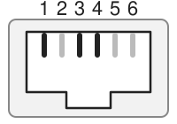
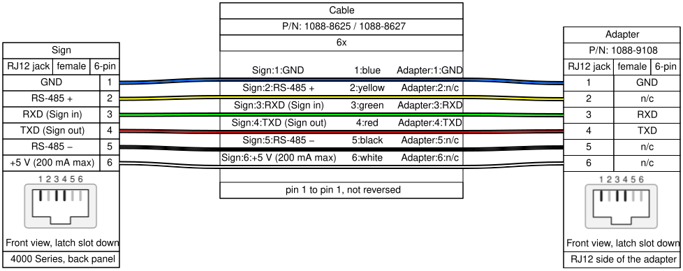
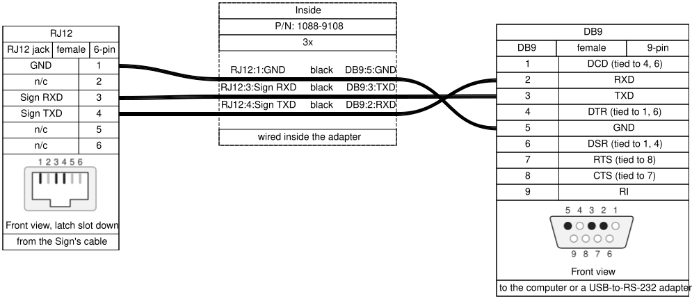
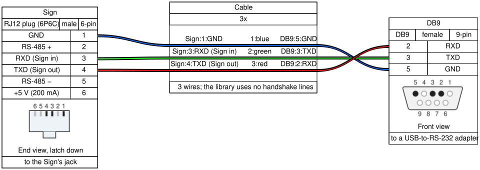

A 4000 Series Sign has one 6-position modular jack on its back. It carries RS-232,
RS-485, and +5 V. One Sign on one computer needs RS-232, and RS-232 needs only three
of the six pins: ground, the Sign's receive line, and its transmit line.

Alpha's manuals call this jack RJ11 in some places and RJ12 in others. It has six
contacts (6P6C), and this page calls it RJ12. The pinouts here come from TechMemo
02-0010A (`docs/reference/TM-Network-Cabling-Pinouts.pdf`) and *Networking Alpha
Signs*, 9700-0112C (`docs/reference/M-Networking-Alpha-Signs.pdf`), cited by page.

## The Sign's jack

{fig-alt="The Sign's RJ12 jack from the front, latch slot down, pins 1 to 6 from left to right. Pins 1, 3, and 4 are filled." width="260"}

| Pin | Signal | Use |
|---|---|---|
| 1 | Ground | RS-232 ground. |
| 2 | RS-485 (+) | Only for several Signs on RS-485. |
| 3 | RXD | The Sign receives here. Connect the computer's TXD. |
| 4 | TXD | The Sign sends here. Connect the computer's RXD. |
| 5 | RS-485 (−) | Only for several Signs on RS-485. |
| 6 | +5 V, 200 mA max | Not needed for a serial link. |

Source: TechMemo 02-0010A, p. 3 ("RS232 / RS485 / TTL", the row that lists the 4000
Series), and *Networking Alpha Signs*, p. 35.

## Alpha's cable and adapter

Alpha's own parts for one Sign are a 6-wire cable and an adapter from RJ12 to the
computer's serial port (*Networking Alpha Signs*, p. 10). The cable connects each pin to
the same pin at the other end (p. 35). The adapter brings out only ground, RXD, and
TXD, and ties the computer's handshake lines together so that software that waits on
them still runs (p. 42).

{fig-alt="Sign RJ12 jack pins 1 to 6 wired to the adapter's RJ12 jack pins 1 to 6: blue GND, yellow RS-485 +, green RXD, red TXD, black RS-485 minus, white +5 V."}

The wire colors are Alpha's (p. 35). Colors on a cable that Alpha didn't make can
differ, so check pin to pin with a meter.

### The adapter

The RJ12-to-DB9 adapter (pn 1088-9108, p. 42) plugs into a 9-pin port, which is what
a USB-to-RS-232 adapter has. It crosses the data lines: the Sign's RXD (pin 3) goes to
the computer's TXD (DB9 pin 3), and the Sign's TXD (pin 4) to the computer's RXD (DB9
pin 2).

{fig-alt="RJ12 pin 1 to DB9 pin 5 (GND), RJ12 pin 3 to DB9 pin 3 (TXD), RJ12 pin 4 to DB9 pin 2 (RXD). DB9 pins 7 and 8 are tied, and pins 1, 4, and 6 are tied."}

Part 1036-9010, a cable with the DB9 end built in, replaces the cable and the DB9
adapter (p. 10).

## With a USB-to-RS-232 adapter

A computer with no serial port needs a USB-to-RS-232 adapter with a 9-pin male plug.
Put Alpha's DB9 adapter and cable on it, or make a cable with three wires: the Sign's
pin 3 to the DB9's pin 3, pin 4 to pin 2, and pin 1 to pin 5.

{fig-alt="RJ12 plug pin 1 (blue) to DB9 female pin 5 (GND), pin 3 (green) to DB9 pin 3 (TXD), pin 4 (red) to DB9 pin 2 (RXD)."}

The library opens the port with no hardware or software flow control, so it needs only
those three wires. The ties on RTS, CTS, DTR, DSR, and DCD don't matter to the library,
and they let other software that waits on those lines work.

A USB-to-TTL adapter (the 3.3 V or 5 V kind sold for microcontrollers) is not
RS-232. TechMemo 02-0010A lists this port as "RS232 / RS485 / TTL", but this project
has tested only RS-232 levels. Check your Sign's installation manual before you
connect TTL to it.

## RS-232 or RS-485

*Networking Alpha Signs*, Appendix E (p. 55), marks the 4000 Series' C models (the
4120C, for example) as sensing RS-232 or RS-485 by themselves, and the R models as
having a jumper. Note 3 there says some older 4000 Series controller boards have the
jumper too. On a Sign with the jumper, the left two pins select RS-232 (p. 53). Turn
the power off first: the jumper is next to mains voltage.

## Mistakes to avoid

- **Telephone cords.** Many have only four wires, on pins 2 to 5. They have no ground
  (pin 1), so the Sign never hears the computer. Use a cable with six wires.
- **Reversed cords.** Many flat modular cords connect pin 1 to pin 6. That moves RXD
  and TXD to the wrong pins and can join the Sign's +5 V to the computer's ground.
  Check that pin 1 reaches pin 1 before you plug it in.
- **Powering things from pin 6.** It gives 200 mA at most (TechMemo 02-0010A, p. 3).
  That is not enough for most boards with Wi-Fi.

## Line settings

Alpha 1.0 Signs accept 1200 to 9600 baud, 8N1 or 7E2 (manual, Table 3). The library
defaults to 9600 baud 8N1, which works on this project's 4120C
([hardware results](https://github.com/ellisgeek/alpha-sign-python/blob/main/docs/hardware-results.md)). Set others with the
`--baud` and `--format` options of the [command line](11-command-line.qmd), or the
arguments of `Sign.serial`.

## Check the connection

With the Sign on and the cable in, read the Sign's General Information:

```sh
alpha-led-sign --port /dev/tty.usbserial-1410 info
```

If it times out, check the cable pin to pin, then the jumper, then the line settings.
`alpha-led-sign discover` finds a Sign whose Sign Address you don't know.
